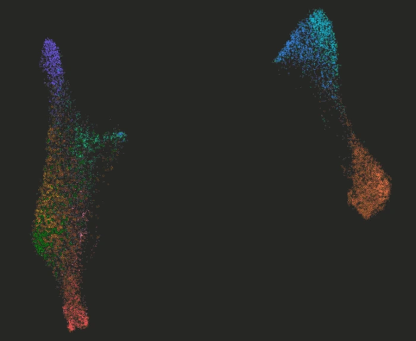
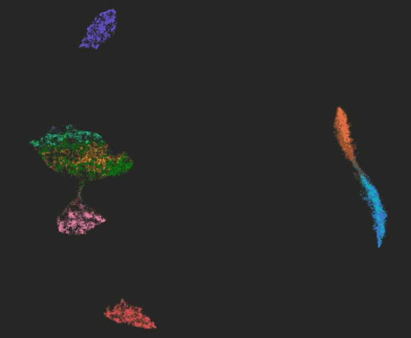
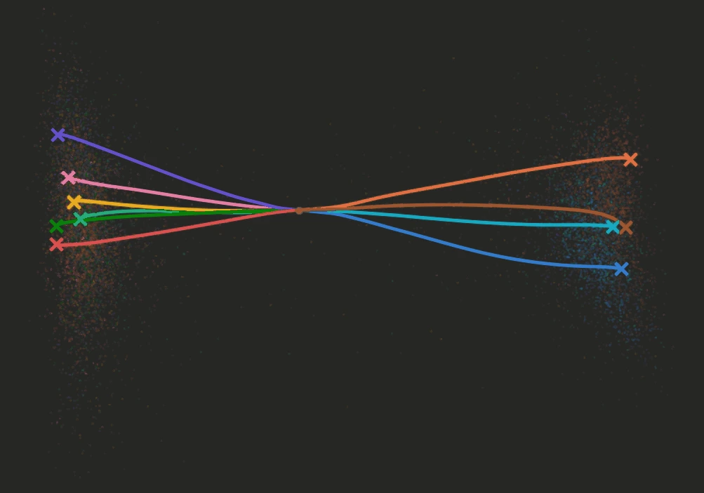

## What I did

I trained VAEs on CIFAR-10 in three ways: with [ConCoS](/works/concos/), with a Euclidean contrastive loss (same-class latents pulled close, other classes pushed past a minimum distance, so distance instead of angle), and with neither. On each VAE I trained an unconditional and a class-conditional latent diffusion model with classifier-free guidance: 5 VAEs and 10 diffusion models in total, on a laptop RTX 4060. The image above shows samples from the class-conditional model on the ConCoS VAE, one class per row.

## What stood out

**ConCoS reached its ideal geometry.** With a compact 64-number latent, the ten classes settled into ten evenly spread directions, at a cosine of −1/9 to each other.

<figure class="wide">
  

    

Euclidean only

    

ConCoS

  

  <ul class="legend"><li><i style="background:#347acc"></i>airplane</li><li><i style="background:#e16f43"></i>automobile</li><li><i style="background:#26ab7c"></i>bird</li><li><i style="background:#e8aa22"></i>cat</li><li><i style="background:#e47ea3"></i>deer</li><li><i style="background:#0a800b"></i>dog</li><li><i style="background:#6351cc"></i>frog</li><li><i style="background:#d9504f"></i>horse</li><li><i style="background:#18a8c0"></i>ship</li><li><i style="background:#9c5530"></i>truck</li></ul>
  <figcaption>UMAP of 10,000 training latents for each VAE, coloured by class.</figcaption>
</figure>

**Length is a safer style dial with ConCoS.** Scaling a latent should change how an image looks but keep its class. ConCoS latents kept their class more often than Euclidean ones (45% against 28% at half length, 49% against 38% at double length).

**ConCoS found its own superclasses.** With an image-like latent, ConCoS put all six animal classes on one direction and all four vehicles on the opposite one, without ever being told about animals or vehicles.

<figure>
  

    

ConCoS

  

  <ul class="legend"><li><i style="background:#347acc"></i>airplane</li><li><i style="background:#e16f43"></i>automobile</li><li><i style="background:#26ab7c"></i>bird</li><li><i style="background:#e8aa22"></i>cat</li><li><i style="background:#e47ea3"></i>deer</li><li><i style="background:#0a800b"></i>dog</li><li><i style="background:#6351cc"></i>frog</li><li><i style="background:#d9504f"></i>horse</li><li><i style="background:#18a8c0"></i>ship</li><li><i style="background:#9c5530"></i>truck</li></ul>
  <figcaption>Class-conditional diffusion paths on the ConCoS VAE, from one shared starting noise, one per class, in PCA of the training latents. Crosses mark where each path ends.</figcaption>
</figure>
