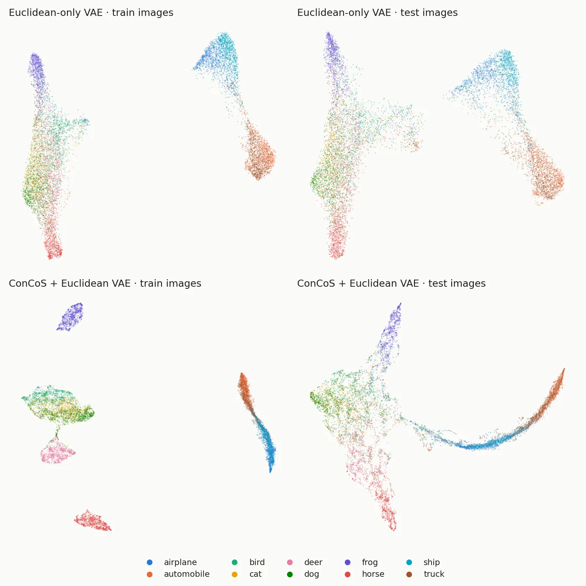

## What I did

I trained VAEs on CIFAR-10 in three ways: with [ConCoS](/works/concos/), with a Euclidean contrastive loss (same-class latents pulled close, other classes pushed past a minimum distance, so distance instead of angle), and with neither. On each VAE I trained an unconditional and a class-conditional latent diffusion model with classifier-free guidance: 5 VAEs and 10 diffusion models in total, on a laptop RTX 4060. The image above shows samples from the class-conditional model on the ConCoS VAE, one class per row.

## What stood out

**ConCoS found its own superclasses.** With an image-like latent, ConCoS put all six animal classes on one direction and all four vehicles on the opposite one, without ever being told about animals or vehicles.

**ConCoS reached its ideal geometry.** With a compact 64-number latent, the ten classes settled into ten evenly spread directions, at a cosine of −1/9 to each other.

**Length is a safer style dial with ConCoS.** Scaling a latent should change how an image looks but keep its class. ConCoS latents kept their class more often than Euclidean ones (45% against 28% at half length, 49% against 38% at double length), and the image changed less.

<figure>
  
  <figcaption>UMAP of 10,000 latents per panel, for the Euclidean-only VAE (top) and the ConCoS VAE (bottom), on train and test images.</figcaption>
</figure>
