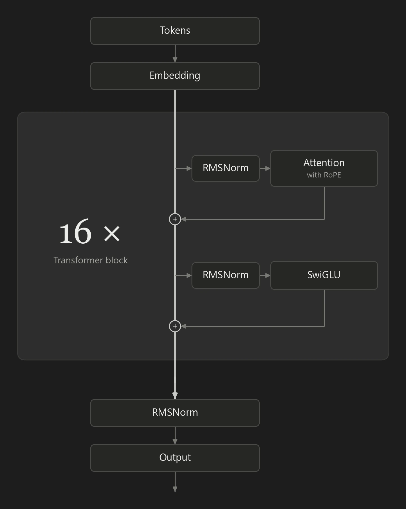
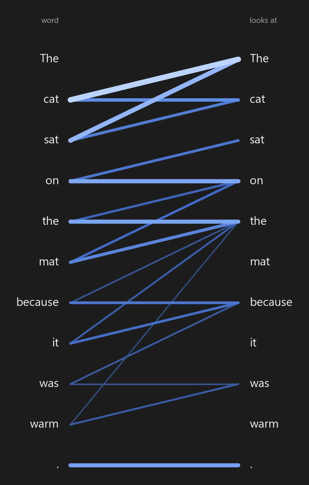
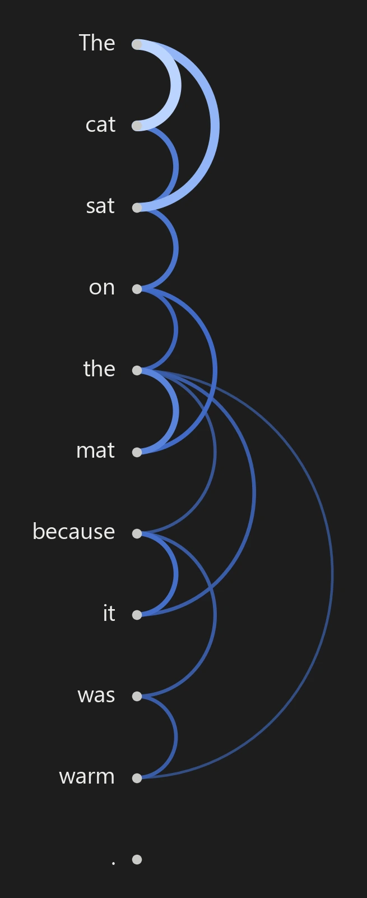

## Overview

lm-FineWeb trains a decoder-only transformer on FineWeb, a large dataset of filtered web text.

## Architecture

- **RMSNorm** for layer normalisation
- **SwiGLU** activations in the feed-forward layers
- **Rotary position embeddings (RoPE)** to encode token positions
- A **custom byte-pair encoding (BPE) tokenizer**, trained for this project

<figure>
  
</figure>

## Results

In November 2026, a 257M-parameter model trained on 1.9B tokens reached a validation loss of 3.20.

## Attention

<figure>
  

    
    
  

  <figcaption>Attention on an example sentence, drawn two ways: as lines from each word to the words it looks at (left), and as arcs between the words (right). Brighter and thicker means more attention.</figcaption>
</figure>
