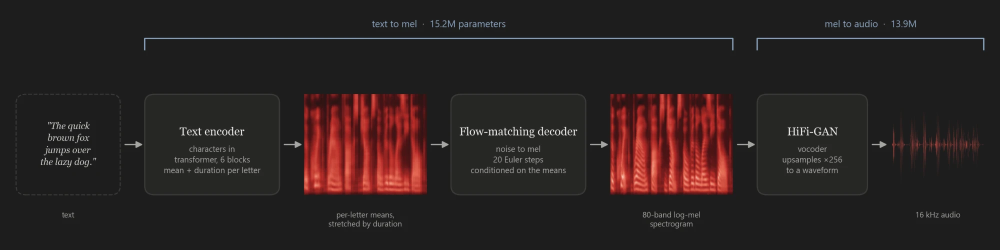

## Listen

Two sentences generated from text at 1.3× speed. Each word is drawn where the model placed it.





## How it works

I built a text-to-speech system in two stages and trained both from scratch on LJSpeech, a public dataset of one speaker reading non-fiction, on a laptop RTX 4060. It uses no pretrained weights, no external aligner and no phonemizer: the model reads plain characters and learns how spelling maps to sound from the data alone.

<figure class="wide">
  
</figure>

**Text to mel** (15.2M parameters), after Matcha-TTS. A transformer encoder predicts a mean spectrogram frame and a duration for every letter. During training, monotonic alignment search finds which letters belong to which frames, so the model learns its own timing. A flow-matching decoder then turns noise into an 80-band mel spectrogram in 20 steps.

**Mel to audio** (13.9M parameters), after HiFi-GAN. The vocoder upsamples the spectrogram 256 times into a 16 kHz waveform.

A small web app goes with it: type text and hear it, or record, load or paint a spectrogram and hear what the vocoder makes of it.

